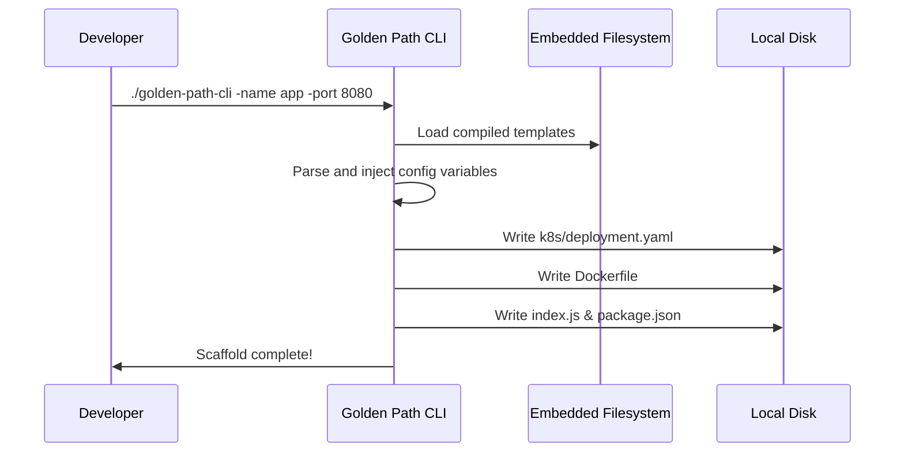
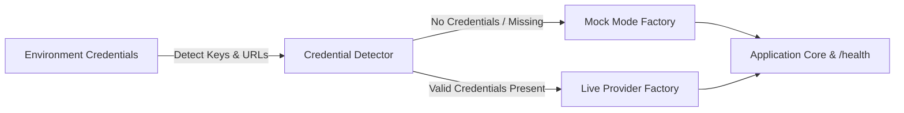

# Golden Path CLI Architecture
> Maturity: Full Prototype

## Overview
The `golden-path-cli` is a Go-based standalone executable designed for Platform Engineering teams to scaffold secure, standardized microservices. Instead of distributing templates as separate files, the templates are baked directly into the compiled binary using Go's `embed` package, ensuring the tool is highly portable.

## System Diagram
The following Mermaid.js sequence diagram maps the core workflow and interactions:

## Component Breakdown
- **Core Technology**: Go (1.21+), `embed.FS`, `text/template`
- **Output Artifacts**: Express API, Distroless Dockerfile, Kubernetes manifests, GitHub Actions CI.
- **Design Paradigm**: Emphasizes secure-by-default boilerplate, removing cognitive load from developers.

## Security Considerations
- **Immutable Templates**: By embedding templates into the binary at compile time, they cannot be tampered with or accidentally modified on the local machine before generation.
- **Zero-Trust Defaults**: Generated Kubernetes manifests enforce `runAsNonRoot: true`, `readOnlyRootFilesystem: true`, and drop all capabilities to prevent container escapes.

## Progressive Credential Loading & Production Architecture (v0.2.0)

This service implements the **Progressive Credential Loading (PCL)** pattern, decoupling development speed from external infrastructure provisioning:

### Core Architecture Components
1. **Mode Detection Singleton:** Inspects environment configuration at boot time without hard crashes on missing secrets.
2. **Dual-Mode Factory Wrappers:**
   - **Storage / Cache:** In-process maps or SQLite `:memory:` transparently promote to managed Redis or PostgreSQL when connection strings are supplied.
   - **AI Providers:** Deterministic heuristic generators and local embeddings transparently promote to live OpenAI, Anthropic, or Gemini API clients.
3. **Hot-Reload & Dynamic TLS:** File watchers monitor mounted volume paths (Kubernetes ConfigMaps and Secrets) to update certificates and limit configs atomically without process restarts.
4. **Health & Observability:** The `/health` endpoint exposes real-time runtime mode metadata (`mock` vs `live`) across all backing adapters.
